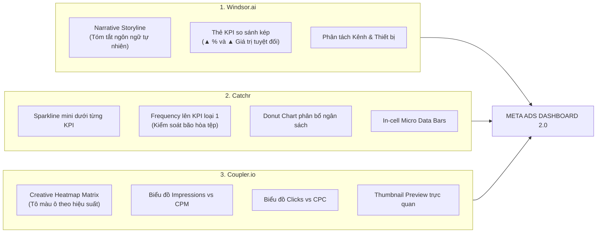

# KẾ HOẠCH NÂNG CẤP GIAO DIỆN & TRẢI NGHIỆM NGƯỜI DÙNG (UI/UX)
# DỰ ÁN: META ADS DASHBOARD (8 TÀI KHOẢN QUẢNG CÁO)

> **Căn cứ**: Phân tích chuyên sâu 3 mô hình dashboard hàng đầu thế giới (**Windsor.ai**, **Catchr**, **Coupler.io**) kết hợp kiến trúc kỹ thuật thực tế của dự án (**Google Apps Script + Google Sheets + Single-Page Web App**).  
> **Mục tiêu**: Lột xác toàn diện giao diện từ phong cách bảng biểu thô sơ (Facebook 2018) thành **Executive Performance Marketing Dashboard** hiện đại, tinh gọn, tự động cảnh báo bão hòa tệp/nội dung và tối ưu cho quản trị đa tài khoản.

---

## 1. Đánh Giá Hiện Trạng UI/UX & Khoảng Trống (Gap Analysis)

Dự án hiện tại đã sở hữu một backend rất mạnh mẽ (hỗ trợ 8-9 tài khoản quảng cáo, 3 tầng Google Sheets tự động phục hồi, đồng bộ pipeline đa luồng và cache ảnh thumbnail creative). Tuy nhiên, phần giao diện frontend (`index.html` / `apps-script/Dashboard.html`) đang bộc lộ những nhược điểm lớn:

```
┌────────────────────────────────────────────────────────────────────────────────────────┐
│                                   HIỆN TRẠNG UI/UX                                     │
├───────────────────────────────┬────────────────────────────────────────────────────────┤
│ 1. Thị giác & Màu sắc         │ • Lai tạp màu xanh Meta (#0866FF) và đỏ san hô (#F2545B)│
│                               │ • Nền xám cũ (#F0F2F5), viền dày, thiếu chiều sâu.     │
│                               │ • Mật độ thị giác không đồng đều, trông như tool nội bộ│
├───────────────────────────────┼────────────────────────────────────────────────────────┤
│ 2. Hero & Executive Summary   │ • Không có câu tóm tắt điều hành (Narrative Storyline).│
│                               │ • Sếp/Marketer vào web phải tự cộng trừ nhẩm số liệu.  │
├───────────────────────────────┼────────────────────────────────────────────────────────┤
│ 3. Thẻ KPI (KPI Cards)        │ • 14 thẻ số tĩnh xếp phẳng lì, chỉ hiển thị số kỳ này. │
│                               │ • Không có Sparkline mini thể hiện nhịp biến động ngày.│
│                               │ • Không có Delta so sánh kép (% thay đổi & số tuyệt đối│
├───────────────────────────────┼────────────────────────────────────────────────────────┤
│ 4. Bão hòa tệp & Quảng cáo    │ • Tần suất (Frequency) và CPM chỉ là số thông thường.  │
│                               │ • Thiếu bộ cảnh báo Audience Fatigue & Creative Decay. │
├───────────────────────────────┼────────────────────────────────────────────────────────┤
│ 5. Quản trị Đa Tài Khoản      │ • Dù có 8-9 tài khoản nhưng gom số thành một cục.      │
│                               │ • Thiếu biểu đồ so sánh tỷ trọng ngân sách & ROAS giữa │
│                               │   các tài khoản quảng cáo (Account Share).             │
├───────────────────────────────┼────────────────────────────────────────────────────────┤
│ 6. Bảng biểu (Tables)         │ • Bảng phẳng, số dày đặc, chữ nhỏ, khó quét mắt.       │
│                               │ • Thiếu In-cell Micro Data Bars & Heatmap Shading.     │
├───────────────────────────────┼────────────────────────────────────────────────────────┤
│ 7. Biểu đồ (Charts)           │ • Chỉ có 1 biểu đồ trend Spend/Results & 1 Bar objective│
│                               │ • Thiếu cặp biểu đồ Media Buying: Impressions vs CPM,  │
│                               │   Clicks vs CPC.                                       │
├───────────────────────────────┼────────────────────────────────────────────────────────┤
│ 8. Mẫu quảng cáo (Creatives)  │ • Thẻ Card quá to, không xem được tổng quan 50-100 ad. │
│                               │ • Thiếu chế độ xem bảng ma trận Heatmap kèm thumbnail. │
├───────────────────────────────┼────────────────────────────────────────────────────────┤
│ 9. Ngôn ngữ & Định dạng       │ • Pha trộn tiếng Anh / Việt; hàm tiền tệ tên `peso()`; │
│                               │   ký tự `₫` bị lỗi encoding UTF-8 (`â‚«`).              │
└───────────────────────────────┴────────────────────────────────────────────────────────┘
```

---

## 2. Học Hỏi Tinh Hoa Từ 3 Giao Diện Mẫu Chuẩn Quốc Tế



---

## 3. Kiến Trúc Giao Diện Mới: "Executive Performance Matrix"

Giao diện mới được tái thiết kế theo cấu trúc **5 tầng phân cấp thông tin (Information Architecture)** từ bao quát điều hành đến chi tiết kỹ thuật:

```
┌──────────────────────────────────────────────────────────────────────────────────────────┐
│ HEADER: Logo Meta Ads Pro | Multi-Account Dropdown (8 TK) | Date Picker | Pipeline Fresh │
├──────────────────────────────────────────────────────────────────────────────────────────┤
│ TẦNG 1: NARRATIVE EXECUTIVE BANNER & TỶ TRỌNG 8 TÀI KHOẢN (Account Allocation Bar)       │
│ [ Câu tóm tắt kinh doanh tự động ]  •  [ Thanh phân bổ ngân sách 8 tài khoản đa sắc ]    │
├──────────────────────────────────────────────────────────────────────────────────────────┤
│ TẦNG 2: BỘ THẺ KPI PHỄU TOÀN DIỆN (FULL-FUNNEL) KÈM MINI SPARKLINES & SO SÁNH KỲ TRƯỚC  │
│ [Chi tiêu + Δ + Spark] [Hiển thị + Δ] [Tiếp cận + Δ] [Tần suất (Cảnh báo bão hòa) + Δ]  │
│ [Số Click + Δ + Spark] [CTR Link + Δ] [CPC + Δ]      [CPM (Áp lực đấu thầu) + Δ]        │
│ [Kết quả/Đơn + Δ]      [CPA + Δ]      [Doanh số + Δ] [ROAS Hoàn vốn + Δ + Sparkline]    │
├──────────────────────────────────────────────────────────────────────────────────────────┤
│ TẦNG 3: BỘ BIỂU ĐỒ MEDIA BUYING & PHÂN BỔ ĐA CHIỀU (4 Charts Grid)                       │
│ 1. Combo Trend: Chi tiêu vs Doanh số & ROAS   │ 2. Đấu thầu: Impressions (Cột) vs CPM (Đường)│
│ 3. Phân bổ: Chi tiêu theo 8 Tài Khoản (Donut) │ 4. Lưu lượng: Clicks (Cột) vs CPC (Đường)    │
├──────────────────────────────────────────────────────────────────────────────────────────┤
│ TẦNG 4: SMART MATRIX TABLES (Tích hợp Micro Data Bars & Heatmap Shading)                 │
│ • Tabs chuyển cấp độ: [ Tất cả Tài Khoản ] [ Chiến Dịch ] [ Nhóm QC ] [ Mẫu QC ]        │
│ • Bảng dữ liệu có thanh đo độ lớn (Data Bar) cho Chi tiêu/Doanh số & Heatmap cho ROAS/CPA│
├──────────────────────────────────────────────────────────────────────────────────────────┤
│ TẦNG 5: CREATIVE LAB & THUMBNAIL MATRIX (Phân hạng Hero Ads / Waste Ads)                 │
│ • Toggle View: [ Heatmap Matrix Table ]  vs  [ Visual Creative Cards ]                   │
│ • Thumbnail ảnh/video 45px, Hook Rate, Hold Rate, Badge phân hạng (Hero, Stable, Burn)  │
└──────────────────────────────────────────────────────────────────────────────────────────┘
```

---

## 4. Đặc Tả Chi Tiết Từng Hạng Mục Cải Tiến

### 4.1. Hệ Thống Thiết Kế Mới (Modern Design System & Token)
- **Phong cách**: Modern Executive Dark/Light Sleek (kết hợp tông Slate tối thượng lưu và điểm nhấn Meta Blue + Emerald).
- **Màu sắc chỉ báo (Semantic Palette)**:
  - `Thành công / Hiệu quả cao`: `#10B981` (Emerald Green) thay vì xanh lá chói.
  - `Cảnh báo / Bão hòa`: `#F59E0B` (Amber Orange).
  - `Nguy hiểm / Đốt tiền / Lỗ`: `#EF4444` (Crimson Red).
  - `Thương hiệu Meta Ads`: `#0064E0` & `#0866FF` (Deep Meta Blue).
  - `Nền & Thẻ`: Nền xám mát `#F8FAFC` (Slate-50), Thẻ card trắng tinh `#FFFFFF` với viền siêu mảnh `border: 1px solid #E2E8F0` và đổ bóng mềm `box-shadow: 0 1px 3px rgba(0,0,0,0.05)`.
- **Typography**: Phông chữ `Inter`, hỗ trợ `font-feature-settings: 'tnum'` (Tabular Numbers) giúp các cột số tiền tệ và phần trăm thẳng tắp hàng dọc.

---

### 4.2. Tầng 1: Narrative Executive Banner & Thanh Phân Bổ Ngân Sách
Mỗi khi chọn ngày hoặc chọn tài khoản, hệ thống tự động tổng hợp câu phân tích điều hành (Dynamic Narrative) để báo cáo sếp/khách hàng chỉ trong 3 giây:

- **Logic sinh câu tóm tắt**:
  - *Khi ROAS ≥ Mục tiêu (Ví dụ ≥ 2.5x)*:
    > 🟢 **Tình hình kinh doanh tốt**: Trong kỳ này, 8 tài khoản đã chi tiêu **[X] Tr ₫**, tạo ra **[Y] đơn hàng/lead** với doanh số **[Z] Tr ₫** (ROAS đạt **[R]x**, tăng **▲ [Δ]%**). Tài khoản dẫn đầu là **[Tên TK tốt nhất]** với ROAS đạt **[R_top]x**.
  - *Khi Frequency > 2.8 hoặc CPA tăng > 20%*:
    > 🟠 **Cảnh báo bão hòa tệp**: Chi phí mỗi kết quả (CPA) đang tăng **▲ [Δ]%** lên **[CPA] ₫** do tần suất hiển thị trung bình đã chạm mức **[F] lần**. Khuyến nghị thay mới hình ảnh/video (creative) và mở rộng tệp tương tự (Lookalike/Broad).
- **Thanh phân bổ ngân sách 8 tài khoản (Account Allocation Strip)**:
  Một thanh ngang đa sắc chia theo % ngân sách của từng tài khoản quảng cáo (Hoa, Tấn, Thảo, Phương...), hover vào hiện chi tiêu và ROAS của từng tài khoản.

---

### 4.3. Tầng 2: Thẻ KPI Phễu Toàn Diện Kèm Mini Sparklines & So Sánh Kép
Tái cấu trúc 14 thẻ số thành cụm phễu 3 tầng logic:

1. **Top Funnel (Nhận diện & Tệp)**:
   - **Tổng Chi tiêu** (*Spend*): Có Sparkline 14 ngày + So sánh kỳ trước (`▲ 12.5% (+15.4 Tr ₫)`).
   - **Lượt Hiển thị** (*Impressions*) & **Tiếp cận** (*Reach*).
   - **Tần suất hiển thị** (*Frequency*): Có **Audience Fatigue Badge** (Xanh < 2.2, Vàng 2.2-2.8, Đỏ > 2.8).
2. **Mid Funnel (Lưu lượng & Tương tác)**:
   - **Lượt Nhấp** (*Link Clicks*) & **Tỷ lệ Nhấp** (*CTR Link*).
   - **Giá mỗi Click** (*CPC*).
   - **Giá mỗi 1.000 lượt hiển thị** (*CPM*): Đo lường độ đắt đỏ của phiên đấu thầu Facebook.
3. **Bottom Funnel (Chuyển đổi & Lợi nhuận)**:
   - **Số Lượng Kết quả/Đơn hàng** (*Results / Purchases*).
   - **Chi phí mỗi kết quả** (*CPA / Cost per Purchase*).
   - **Doanh thu Chuyển đổi** (*Purchase Value*).
   - **Tỷ suất Lợi nhuận ROAS** (*Blended ROAS*): Điểm nhấn lớn nhất, tô màu Emerald nổi bật, kèm Sparkline xu hướng.

---

### 4.4. Tầng 3: Bộ 4 Biểu Đồ Media Buying Chuyên Sâu
Thay vì chỉ 1 biểu đồ đường đơn điệu, bổ sung cụm 4 biểu đồ phục vụ trực tiếp việc ra quyết định vít ngân sách hoặc tắt camp:

```
┌──────────────────────────────────────────────┬──────────────────────────────────────────────┐
│ 1. BIỂU ĐỒ XU HƯỚNG HIỆU QUẢ KINH DOAN       │ 2. BIỂU ĐỒ ÁP LỰC ĐẤU THẦU (AUCTION PRESSURE)│
│ • Cột: Chi tiêu hàng ngày (VNĐ)              │ • Cột: Lượt hiển thị (Impressions)           │
│ • Đường: ROAS & Doanh thu                    │ • Đường: Giá thầu hiển thị CPM (VNĐ/1K impr) │
│ -> Giúp nhận biết khi tăng tiền thì ROAS     │ -> Phát hiện khi tăng ngân sách thì CPM bị   │
│    có bị gãy hay không.                      │    đội lên đắt gấp đôi do tệp quá hẹp.       │
├──────────────────────────────────────────────┼──────────────────────────────────────────────┤
│ 3. BIỂU ĐỒ PHÂN BỔ NGÂN SÁCH ĐA TÀI KHOẢN    │ 4. BIỂU ĐỒ CHẤT LƯỢNG LƯU LƯỢNG (TRAFFIC EFF)│
│ • Donut Chart 2 vòng:                        │ • Cột: Lượt nhấp chuột (Clicks)              │
│   - Vòng trong: 8 Tài khoản quảng cáo        │ • Đường: Giá mỗi nhấp chuột (CPC)            │
│   - Vòng ngoài: Mục tiêu (Sales, Leads, Mess)│ -> Đo lường mẫu quảng cáo còn thu hút hay    │
│ -> Kiểm soát tài khoản nào đang tiêu quá tay.│    đang bị khán giả lướt qua (mệt mỏi nội dung).│
└──────────────────────────────────────────────┴──────────────────────────────────────────────┘
```

---

### 4.5. Tầng 4: Bảng Biểu Ma Trận Thông Minh (In-Cell Bars & Heatmap)
Khắc phục triệt để nhược điểm "bảng phẳng khô khan":

- **In-Cell Micro Data Bars**:
  - Tại cột *Chi tiêu (Spend)* và *Doanh số (Value)*, một thanh màu nằm chìm dưới chân chữ số thể hiện tỷ lệ % so với dòng lớn nhất. Nhìn lướt là thấy ngay chiến dịch nào đang "hút" nhiều tiền nhất.
- **Heatmap Cell Shading (Tô màu nền có điều kiện)**:
  - Cột *ROAS*: Ô xanh đậm (ROAS > 3.0), xanh nhạt (2.0 - 3.0), vàng (1.5 - 2.0), đỏ nhạt (< 1.5).
  - Cột *CPA*: Ô xanh khi CPA thấp hơn mục tiêu, ô cam/đỏ khi vượt ngân sách cho phép.
  - Cột *CTR Link*: Tự động highlight nếu CTR < 1.0% (báo hiệu creative yếu).
- **Bộ lọc nhanh (Quick Filters)**:
  - Thêm các nút lọc 1-click: `Top Chi Tiêu`, `Top ROAS Cao`, `Cảnh Báo Cháy Tệp (Freq > 2.8)`, `Chi Phí Cao Chưa Ra Đơn (Wasted Spend)`.

---

### 4.6. Tầng 5: Creative Lab & Thumbnail Matrix (Coupler.io Style)
Tối ưu hóa vũ khí quan trọng nhất của Meta Ads: **Mẫu quảng cáo (Creative)**:

- **2 Chế độ hiển thị (View Switcher)**:
  1. **Heatmap Table View (Mặc định)**: Bảng ma trận cực gọn hiển thị 100+ creative cùng lúc:
     - Cột 1: Thumbnail ảnh/video 45x45px (hover vào phóng to 200px xem ảnh/video trực tiếp).
     - Cột 2: Tên Ad, Adset, Campaign và Tên Tài khoản.
     - Cột 3-7: Chi tiêu, ROAS, CPA, CTR, Frequency (đều có Heatmap shading).
     - Cột 8: Phân hạng hành động (**Action Badge**).
  2. **Visual Card View**: Giữ lại lưới thẻ trực quan hiện tại nhưng tinh gọn kích thước thẻ, bổ sung chỉ số Hook Rate (3-sec play / impressions) và Hold Rate (100% play / impressions).
- **Thuật toán Phân Hạng Creative Thông Minh**:
  - 🟢 **Scale-Ready (Hero Ad)**: ROAS $\ge$ 2.5, CPA $\le$ Benchmark, Frequency < 2.0 $\rightarrow$ *Gợi ý: Tăng ngân sách 20%/ngày*.
  - 🟡 **Stable (Ổn định)**: Hiệu suất tốt, duy trì chạy bình thường.
  - 🟠 **Fatigued (Cháy tệp)**: Frequency $\ge$ 2.8, CTR giảm liên tục $\rightarrow$ *Gợi ý: Đổi 3s đầu (Hook), đổi thumbnail*.
  - 🔴 **Burn Money (Đốt tiền)**: Chi tiêu > $2 \times$ CPA mục tiêu nhưng 0 kết quả $\rightarrow$ *Gợi ý: Tắt ngay lập tức*.

---

### 4.7. Chuẩn Hóa Bản Địa Hóa & Định Dạng Tiền Tệ VNĐ
- **Xóa bỏ hàm `peso()` cũ và lỗi font UTF-8**:
  Thay thế bằng hàm format tài chính tiếng Việt chuẩn xác:
  ```javascript
  function formatVND(n, compact = false) {
    if (n === null || n === undefined || isNaN(n)) return '0 ₫';
    n = Number(n);
    if (compact) {
      if (Math.abs(n) >= 1e9) return (n / 1e9).toFixed(2) + ' Tỷ ₫';
      if (Math.abs(n) >= 1e6) return (n / 1e6).toFixed(1) + ' Tr ₫';
      if (Math.abs(n) >= 1e3) return (n / 1e3).toFixed(0) + ' K ₫';
    }
    return Math.round(n).toLocaleString('vi-VN') + ' ₫';
  }
  ```
- **100% Tiếng Việt Chuẩn Thuật Ngữ Performance Marketing**:
  - Không dùng những từ dịch máy thô kệch.
  - Sử dụng thuật ngữ quen thuộc của Media Buyer Việt Nam: *Chi tiêu, Hiển thị, Tiếp cận, Tần suất, Nhấp liên kết, Tỷ lệ nhấp (CTR), Giá mỗi nhấp (CPC), Giá hiển thị (CPM), Đơn hàng / Chuyển đổi, Giá mỗi đơn (CPA), Doanh thu, Tỷ suất hoàn vốn (ROAS)*.

---

## 5. Lộ Trình Triển Khai Kỹ Thuật (Actionable Roadmap)

Kế hoạch được chia làm 4 giai đoạn logic, hoàn toàn tương thích với kiến trúc Single-file `index.html` và backend Google Apps Script:

### Giai đoạn 1: Nâng cấp Nền Tảng Thiết Kế, Bản Địa Hóa & Smart Narrative (Tuần 1)
- [ ] Tái cấu trúc CSS biến định kiểu (Design Tokens: Slate palette, Emerald, Crimson, Amber, Tabular Numbers).
- [ ] Chuẩn hóa hàm format `formatVND()` (hỗ trợ hiển thị gọn: `Tr ₫`, `Tỷ ₫`, `K ₫`), sửa triệt để lỗi encoding `â‚«`.
- [ ] Xây dựng Module **Executive Narrative Storyline**: Tự động sinh câu tóm tắt tình hình 8 tài khoản ở đầu trang.
- [ ] Bổ sung thanh phân bổ ngân sách 8 tài khoản (**Account Allocation Bar**) trực quan ngay dưới header.

### Giai đoạn 2: Nâng Cấp Bộ Thẻ KPI Phễu & Mini Sparklines (Tuần 1 - 2)
- [ ] Tái cấu trúc lại lưới KPI theo 3 tầng phễu (Top, Mid, Bottom Funnel).
- [ ] Đưa chỉ số **Frequency (Tần suất)** và **CPM** lên nhóm chỉ số loại 1 với huy hiệu cảnh báo bão hòa tệp.
- [ ] Tích hợp **Mini Sparklines** bằng Canvas/SVG cho từng thẻ KPI chính (Chi tiêu, ROAS, Kết quả, CTR).
- [ ] Bổ sung logic tính toán **So sánh kép (Dual Delta)**: Hiển thị đồng thời `% thay đổi` và `giá trị tuyệt đối` so với chu kỳ trước.

### Giai đoạn 3: Hiện Đại Hóa Bảng Biểu & Bộ 4 Biểu Đồ Media Buying (Tuần 2 - 3)
- [ ] Xây dựng bộ 4 biểu đồ Chart.js:
  1. *Trend Combo (Chi tiêu vs ROAS & Doanh thu)*.
  2. *Đấu thầu (Impressions vs CPM)*.
  3. *Lưu lượng (Clicks vs CPC)*.
  4. *Phân bổ đa tài khoản & mục tiêu (Donut)*.
- [ ] Tích hợp **In-Cell Micro Data Bars** vào bảng Chiến Dịch và Nhóm Quảng Cáo.
- [ ] Tích hợp **Heatmap Cell Shading** cho các cột chỉ số quan trọng (ROAS, CPA, CTR).
- [ ] Thêm các nút lọc nhanh 1-click (Top Spend, Top ROAS, Cảnh báo bão hòa).

### Giai đoạn 4: Đột Phá Module "Creative Matrix & Ad Gallery" (Tuần 3 - 4)
- [ ] Xây dựng chế độ xem bảng **Creative Heatmap Matrix** kết hợp thumbnail 45px (zoom preview 200px khi hover).
- [ ] Bổ sung phân hạng tự động 4 nhóm: *Hero Scale-Ready, Stable, Fatigued, Burn Money*.
- [ ] Tối ưu hóa bộ lọc phân tích theo Vị trí hiển thị (*Placement: Feed, Reels, Stories*) và Thiết bị (*Mobile vs Desktop*).
- [ ] Đồng bộ toàn bộ code cải tiến sang `apps-script/Dashboard.html` và kiểm tra 100% chế độ Offline Demo cũng như Online GAS.

---

## 6. Tiêu Chí Đo Lường Thành Công (Success Metrics)

| Chỉ số đánh giá | Trước nâng cấp | Sau nâng cấp |
| :--- | :--- | :--- |
| **Thời gian nắm bắt bức tranh tài khoản** | > 30 giây (phải đọc từng số) | < 3 giây (đọc câu tóm tắt Narrative) |
| **Tốc độ phát hiện Ad/Tệp bị bão hòa** | Khó nhận diện | Phát hiện tức thì nhờ Fatigue Badge & Biểu đồ CPM |
| **Tốc độ tìm ra Hero Ad / Wasted Ad** | Phải sort tay từng cột | Quét mắt 2 giây nhờ Heatmap Shading & Phân hạng |
| **Trải nghiệm trực quan & Thẩm mỹ** | 5/10 (Giao diện tool nội bộ thô) | 9.5/10 (Chuẩn SaaS Executive Dashboard quốc tế) |
| **Khả năng quản trị đồng thời 8 tài khoản** | Rời rạc, chỉ có dropdown | Trực quan với Donut Share & Account Bar |
